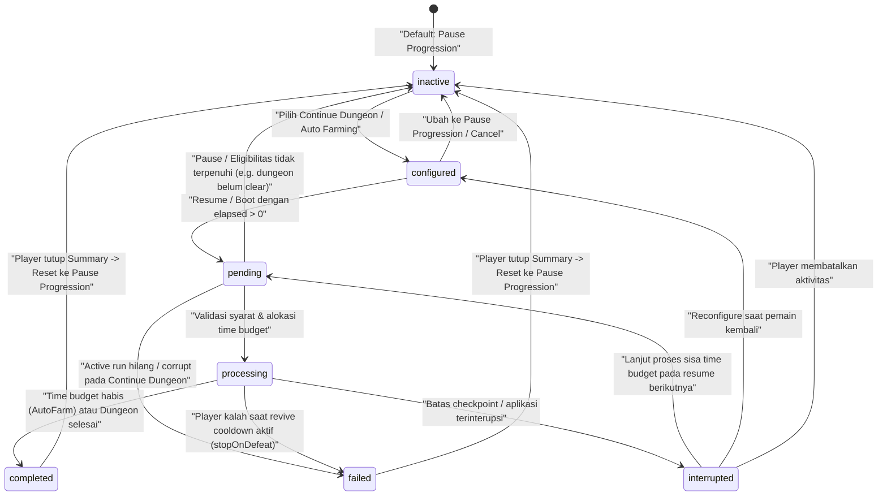

\# ECHOES OF AETHER

\## TECHNICAL DESIGN DOCUMENT (TDD)


\*\*Document Version:\*\* 1.0  

\*\*Project:\*\* Echoes of Aether  

\*\*Platform:\*\* Android First  

\*\*Framework:\*\* Flutter  

\*\*Game Engine:\*\* Flame  

\*\*Architecture:\*\* Clean Architecture-inspired Modular Architecture  

\*\*Database:\*\* SQLite through Drift  

\*\*Document Status:\*\* Initial Technical Baseline


\---


\# 1. TECHNICAL OVERVIEW


\## 1.1 Purpose


Dokumen ini menjelaskan arsitektur, teknologi, struktur kode, gameplay simulation, data management, dan implementasi teknis Echoes of Aether.


Tujuannya adalah menjaga agar pengembangan tetap konsisten, modular, mudah diuji, dan dapat dikembangkan tanpa menciptakan ketergantungan yang tidak diperlukan.


\## 1.2 Technology Stack


| Technology | Responsibility |

|---|---|

| Flutter | Application UI |

| Flame | 2D game rendering and world |

| Riverpod | State management and dependency injection |

| Drift | Local database abstraction |

| SQLite | Persistent storage |

| Freezed | Immutable models and unions |

| JSON | Static game configuration |

| Flame Audio | Game audio |


Versi dependency harus mengikuti versi stabil yang kompatibel ketika implementasi dilakukan.


\---


\# 2. ARCHITECTURE PRINCIPLES


\## 2.1 Main Architecture


Arsitektur menggunakan pendekatan Clean Architecture yang disesuaikan dengan kebutuhan game.


Lapisan utama:


1\. Presentation Layer.

2\. Application Layer.

3\. Domain Layer.

4\. Game Layer.

5\. Data Layer.


\## 2.2 Dependency Rules


\- Domain tidak boleh bergantung pada Flutter.

\- Domain tidak boleh bergantung pada Flame.

\- Domain tidak boleh bergantung pada Drift.

\- Application menggunakan domain melalui interface.

\- Data mengimplementasikan repository interface.

\- Game Layer bertanggung jawab pada rendering dan integrasi game engine.

\- Presentation Layer bertanggung jawab pada UI.


\## 2.3 Authoritative Gameplay State


Domain dan Application menjadi sumber kebenaran gameplay state.


Flame components hanya menjadi adapter visual dan interaksi dengan game world.


Flame components tidak boleh menjadi satu-satunya tempat penyimpanan:

\- HP authoritative.

\- EXP.

\- Gold.

\- Equipment ownership.

\- Skill progression.

\- Dungeon progression.

\- Combat results.


\---


\# 3. PROJECT STRUCTURE


Struktur direktori yang direkomendasikan:


```text

echoes\_of\_aether/

├── assets/

│   ├── images/

│   │   ├── characters/

│   │   ├── monsters/

│   │   ├── environments/

│   │   ├── objects/

│   │   ├── items/

│   │   └── effects/

│   ├── maps/

│   ├── audio/

│   ├── fonts/

│   └── data/

│       ├── monsters.json

│       ├── items.json

│       ├── skills.json

│       ├── specializations.json

│       ├── dungeons.json

│       └── loot\_tables.json

│

├── docs/

│   ├── GAME\_DESIGN\_DOCUMENT.md

│   ├── TECHNICAL\_DESIGN\_DOCUMENT.md

│   ├── MASTER\_DEVELOPMENT\_ROADMAP.md

│   └── MILESTONE\_STATUS.md

│

├── lib/

│   ├── main.dart

│   ├── app/

│   │   ├── app.dart

│   │   ├── router.dart

│   │   └── theme/

│   │

│   ├── core/

│   │   ├── constants/

│   │   ├── errors/

│   │   ├── utils/

│   │   └── services/

│   │

│   ├── domain/

│   │   ├── entities/

│   │   ├── enums/

│   │   ├── repositories/

│   │   ├── services/

│   │   └── usecases/

│   │

│   ├── application/

│   │   ├── providers/

│   │   ├── controllers/

│   │   └── usecases/

│   │

│   ├── data/

│   │   ├── models/

│   │   ├── datasources/

│   │   ├── repositories/

│   │   └── database/

│   │

│   ├── game/

│   │   ├── echoes\_game.dart

│   │   ├── world/

│   │   ├── components/

│   │   ├── systems/

│   │   ├── controllers/

│   │   └── overlays/

│   │

│   └── features/

│       ├── home/

│       ├── dungeon/

│       ├── character/

│       ├── inventory/

│       ├── equipment/

│       ├── skills/

│       ├── quests/

│       └── settings/

│

├── test/

│   ├── domain/

│   ├── application/

│   ├── data/

│   ├── game/

│   └── features/

│

└── pubspec.yaml

```


Struktur ini merupakan target arsitektur. Jangan memindahkan seluruh file secara otomatis jika repository saat ini sudah memiliki struktur berbeda yang berjalan baik.


\---


\# 4. DOMAIN DESIGN


\## 4.1 Main Entities


Entity utama yang dibutuhkan:


\- Player

\- PlayerStats

\- Specialization

\- SkillDefinition

\- SkillRuntimeState

\- EquipmentDefinition

\- EquipmentInstance

\- InventoryEntry

\- MonsterDefinition

\- MonsterRuntimeState

\- DungeonDefinition

\- DungeonRun

\- DungeonRoom

\- LootTable

\- CombatState

\- ReviveState

\- OfflineProgressResult


\## 4.2 Static Configuration vs Runtime State


Pisahkan konfigurasi statis dari state runtime.


Contoh:


\*\*SkillDefinition\*\*

\- Skill ID.

\- Name.

\- Type.

\- Base cooldown.

\- Base effect.

\- Scaling configuration.

\- Compatibility.


\*\*SkillRuntimeState\*\*

\- Skill level.

\- Current cooldown.

\- Unlock status.

\- Runtime effect state.


SkillDefinition berasal dari JSON.


SkillRuntimeState berasal dari player progression dan gameplay simulation.


Aturan serupa berlaku untuk monster, equipment, dungeon, dan loot.


\---


\# 5. GAME SIMULATION


\## 5.1 Simulation Authority


Gameplay harus diproses oleh simulation layer yang tidak bergantung pada rendering.


Simulation layer bertanggung jawab atas:

\- Movement decisions.

\- Target selection.

\- Combat.

\- Damage calculation.

\- Skill execution.

\- Monster AI.

\- Death and revive.

\- Loot generation.

\- Progression updates.


Flame hanya menggambarkan hasil simulation melalui rendering dan component updates.


\## 5.2 Fixed Timestep


Baseline simulation:


\- Tick duration: 50 ms.

\- Simulation frequency: 20 ticks per second.

\- Rendering berjalan secara terpisah.


Gunakan accumulator untuk memproses elapsed time dalam fixed simulation steps.


Jangan memanggil lifecycle rendering Flame secara manual untuk menggantikan game loop.


Batasi jumlah catch-up ticks agar simulasi tidak mengalami spiral of death ketika terjadi frame drop.


\## 5.3 Simulation Events


Gunakan event atau command untuk menghubungkan simulation dengan UI dan rendering.


Contoh event:

\- PlayerMoved.

\- TargetChanged.

\- AttackStarted.

\- DamageApplied.

\- SkillExecuted.

\- MonsterDefeated.

\- LootDropped.

\- PlayerLeveledUp.

\- PlayerDowned.

\- PlayerRevived.

\- RoomCompleted.


Jangan mengirim seluruh state simulation ke Riverpod pada setiap tick.


UI hanya menerima perubahan yang relevan dan pembaruan berkala dengan frekuensi yang wajar.


\---


\# 6. MOVEMENT AND PATHFINDING


\## 6.1 Navigation Grid


Navigation grid harus dipisahkan dari visual tilemap.


Data grid minimal mencakup:

\- Grid width.

\- Grid height.

\- Cell size.

\- Walkable state.

\- Obstacle state.

\- Movement cost.


\## 6.2 A\* Pathfinding


Gunakan A\* untuk menemukan jalur menuju target atau posisi serang.


Pathfinding bertanggung jawab atas:

\- Start node.

\- Goal node.

\- Neighbor evaluation.

\- Movement cost.

\- Heuristic.

\- Obstacle avoidance.


\## 6.3 Attack Position


Karakter tidak selalu perlu berjalan tepat ke posisi monster.


Sistem harus menentukan posisi valid yang berada dalam attack range.


Pertimbangkan:

\- Jarak serang.

\- Collision radius.

\- Navigation grid.

\- Posisi target.

\- Obstacle.


Pathfinding tidak perlu dijalankan ulang setiap frame. Gunakan kondisi tertentu seperti target berubah, jalur terhalang, atau target berpindah secara signifikan.


\---


\# 7. COMBAT ARCHITECTURE


\## 7.1 Combat Responsibilities


Combat system menangani:

\- Target selection.

\- Attack interval.

\- Hit validation.

\- Damage calculation.

\- Critical hit.

\- Damage application.

\- Death detection.


\## 7.2 Target Selection


Target selection harus dipisahkan menjadi service tersendiri.


Input:

\- Player position.

\- Available enemies.

\- Enemy states.

\- Target priority configuration.


Output:

\- Selected target ID.


Baseline priority:

1\. Enemy attacking player.

2\. Nearest enemy.

3\. Elite enemy.

4\. Lowest HP enemy.


Pastikan target mati, tidak valid, atau tidak dapat dijangkau tidak terus dipertahankan.


\## 7.3 Damage Calculation


Gunakan service terpusat untuk damage calculation.


Baseline:


```text

baseDamage = max(1, attackerATK - targetDEF)

```


Critical hit:


```text

finalDamage = baseDamage \* criticalMultiplier

```


Implementasi final harus mendukung damage type dan modifier tanpa menduplikasi formula di masing-masing skill.


Gunakan representasi numerik yang konsisten dan aturan pembulatan yang eksplisit.


\## 7.4 Attack Timing


Attack interval:


```text

attackInterval = 1 / attackSpeed

```


Combat timing harus berasal dari simulation clock, bukan durasi animasi sprite.


\---


\# 8. SKILL SYSTEM ARCHITECTURE


\## 8.1 Skill Components


Pisahkan skill menjadi:


1\. Static definition.

2\. Runtime state.

3\. Execution conditions.

4\. Effect calculation.

5\. Effect application.


\## 8.2 Initial Skill Definitions


Skill awal:


\- Power Strike.

\- Aether Burst.

\- Healing Pulse.

\- Vitality.

\- Focus.


\## 8.3 Skill Execution Flow


1\. Simulation memeriksa skill yang tersedia.

2\. Skill priority evaluator menentukan kandidat.

3\. Execution condition memeriksa cooldown dan kondisi gameplay.

4\. Skill executor menjalankan skill.

5\. Effect resolver menghitung hasil.

6\. Hasil diterapkan ke domain state.

7\. Skill cooldown diperbarui.

8\. Event dikirim ke presentation layer.


\## 8.4 Skill Cooldown


Cooldown harus dihitung menggunakan simulation time.


Skill tidak boleh bergantung pada timer visual atau animation completion.


\## 8.5 Data Validation


Skill configuration harus divalidasi ketika JSON dimuat.


Validasi:

\- ID tidak duplikat.

\- Cooldown valid.

\- Scaling configuration valid.

\- Effect type dikenal.

\- Specialization compatibility valid.

\- Required field tersedia.


\---


\# 9. SPECIALIZATION ARCHITECTURE


\## 9.1 Data-driven Specialization


Specialization awal:

\- Vanguard.

\- Arcanist.

\- Ranger.


Setiap specialization menyimpan:

\- ID.

\- Name.

\- Description.

\- Base modifiers.

\- Skill compatibility.

\- Progression rules.


\## 9.2 Derived Stats Service


Gunakan satu service terpusat (`DerivedStatsCalculator` di `domain/services/derived_stats_calculator.dart`) untuk menghitung derived attributes melalui `PlayerCharacter.stats`.


Baseline formula:


```text

Final Stats =

Base Stats (level)

+ Equipment Modifiers

+ Specialization Modifiers

+ Passive Skill Modifiers (dengan skill affinity specialization aktif)

```


Aturan implementasi (`DerivedStatsCalculator` & `StatBounds`):


\- Seluruh 9 atribut tempur (`maxHp`, `atk`, `def`, `attackSpeed`, `critRate`, `critDamage`, `moveSpeed`, `attackRange`, `skillHaste`) dihitung ulang secara murni (*stateless*) dari sumber modifier aktif tanpa mengakumulasi hasil sebelumnya.

\- Seluruh modifier aditif dijumlahkan dalam bentuk pecahan (`double`) terlebih dahulu, lalu pembulatan untuk `maxHp`, `atk`, dan `def` dilakukan sekali pada total akhir untuk menghindari *rounding drift*.

\- Bila specialization aktif mendefinisikan `attackRange`, nilai tersebut menggantikan *base* `attackRange` sebelum ditambahkan bonus `attackRange` aditif dari modifier lain.

\- Hasil akhir dijepit ke `StatBounds` (`maxHp >= 1`, `atk >= 0`, `def >= 0`, `attackSpeed` `0.1..10.0`, `critRate` `0.0..1.0`, `critDamage >= 1.0`, `moveSpeed` `0.1..20.0`, `attackRange` `0.5..20.0`, `skillHaste` `0.0..0.75`).

\- Perubahan equipment, specialization, maupun level skill pasif tidak pernah menggandakan bonus dan langsung tersinkron ke `CombatSimulation` melalui `CombatSystem._syncPlayerBuild`.


\## 9.3 Specialization Switching


Aturan pergantian specialization harus didefinisikan secara eksplisit.


Perubahan specialization tidak boleh:

\- Menggandakan modifier.

\- Menghilangkan equipment.

\- Menghapus skill progression yang masih valid.

\- Menyebabkan state karakter tidak konsisten.


\---


\# 10. MONSTER AI


\## 10.1 Monster State Machine


Monster menggunakan state:


\- Idle.

\- Detect.

\- Chase.

\- Attack.

\- Return.

\- Dead.


\## 10.2 State Responsibilities


\*\*Idle:\*\* menunggu kondisi deteksi.


\*\*Detect:\*\* menentukan apakah pemain berada dalam jangkauan deteksi.


\*\*Chase:\*\* bergerak menuju pemain.


\*\*Attack:\*\* melakukan serangan ketika kondisi terpenuhi.


\*\*Return:\*\* kembali ke posisi awal ketika kondisi combat berakhir.


\*\*Dead:\*\* menghentikan aktivitas dan memproses reward melalui sistem yang berwenang.


\## 10.3 Monster Runtime


Monster runtime harus menyimpan:

\- Monster ID.

\- Current HP.

\- Current state.

\- Position.

\- Target ID.

\- Attack cooldown.

\- Spawn information.


Static monster data tetap berasal dari JSON.


\---


\# 11. DUNGEON ARCHITECTURE


\## 11.1 Dungeon Definition


Dungeon definition memuat:

\- Dungeon ID.

\- Name.

\- Biome.

\- Room sequence.

\- Difficulty configuration.

\- Reward configuration.


\## 11.2 Room Definition


Setiap room memuat:

\- Room ID.

\- Map configuration.

\- Entry position.

\- Exit position.

\- Spawn configuration.

\- Completion condition.

\- Reward configuration.


\## 11.3 Room Manager


Room manager bertanggung jawab atas:

\- Loading room.

\- Spawn encounter.

\- Monitoring completion.

\- Room transition.

\- Reward processing.


MVP menggunakan progression linear.


Struktur data sebaiknya menggunakan ID dan hubungan antar-room agar dapat diperluas menjadi graph di masa depan.


\## 11.4 Room Transition


Transisi room hanya dilakukan setelah completion condition terpenuhi.


Pastikan:

\- Encounter tidak ter-spawn dua kali.

\- Reward tidak diberikan dua kali.

\- State room tersimpan dengan benar.

\- Transition tidak berjalan ketika dungeon run sudah berakhir.

\## 11.5 Dungeon Runtime, Cleanup, dan State Preservation (M5 Stage 1–2)

\- **Konfigurasi Statis (`DungeonConfigParser` & `assets/data/dungeons.json`):** Memuat definisi dungeon linear MVP `forgotten_forest` (5 room: `forest_entrance` -> `ancient_path` -> `ruined_shrine` -> `hidden_chamber` [elite] -> `ancient_heart` [boss]) lengkap dengan referensi map, `entry_position`, `exit_position`, `spawns`, `completion_condition`, dan `reward`, divalidasi oleh `GameConfigValidator`.

\- **Orkestrator Runtime (`DungeonManager` di `lib/domain/services/dungeon_manager.dart`):** Mengelola siklus `DungeonSession` (`notStarted -> inProgress -> roomCompleted -> completed/failed`), siklus `RoomLifecycleState` (`notLoaded -> loading -> ready -> active -> ... -> unloaded`), guard duplikasi pemuatan room, pembersihan room sebelum pemuatan berikutnya, serta event lifecycle murni Dart (`DungeonRuntimeEvent`) untuk `DungeonWorld` tanpa memindahkan damage calculation, monster AI, loot, atau DB write ke `DungeonManager`.

\- **Integrasi World & Cleanup (`DungeonWorld` & `CombatSystem`):** Memuat `NavigationGrid` dari room aktif, memvisualisasikan `exitPosition`, menjaga agar `CombatSimulation.tick()` hanya berjalan saat `roomLifecycle == active`, menunggu komponen transient lama (`DebugRoomComponent`, `EnemyComponent`, `FloatingTextComponent`) dilepas sebelum room berikutnya aktif, memperbarui camera bounds, serta menonaktifkan wave loop sementara `TestRoom` saat berjalan di mode `DungeonManager` (spawning dari `preparedSpawns` dikerjakan pada Stage 3).

\- **Kebijakan Pelestarian State Antar-Room (`CombatSimulation.loadRoom`):**
  - **Dipertahankan dalam 1 run:** HP terakhir player, derived stats, equipment, specialization, skill unlock/level, sisa cooldown skill (`cooldownTicksRemaining`) untuk mencegah exploit reset cooldown di batas room, `reviveCooldownTicks`, dan `currentTick` kontinu. (Memulai run baru dari Town membuat sesi `CombatSimulation` segar sehingga skill dimulai siap pakai.)
  - **Direset saat masuk room baru:** Posisi player ditempatkan di `entryPosition` (divalidasi walkable), jalur pathfinding (`PathFollower`), target combat lama, `plannedGoal`, daftar musuh, event simulasi tertunda, serta visual transient (`resetVisualTransient()`).

\- **Hub Town/Camp Sederhana (`TownHubView` & `DungeonScreen`):** Menyediakan alur `Town -> Forgotten Forest -> Dungeon Runtime -> Town`, akses overlay `Tas`, `Perlengkapan`, dan `Karakter` yang terhubung ke save queue `GameSessionCoordinator`, serta tampilan progres dungeon. (Spawning musuh Stage 3, completion & transisi otomatis Stage 4, serta death/session recovery Stage 5 mengikuti tahap berikutnya.)

\## 11.6 Monster Spawning, Encounter Tracking, dan Elite/Boss Setup (M5 Stage 3)

\- **Domain Encounter & Event (`lib/domain/entities/room_encounter.dart`):** Mendefinisikan `EncounterType` (`normal`, `elite`, `boss`), `EncounterStatus` (`pending`, `active`, `completed`, `failed`), `SpawnedEnemyRecord`, `RoomEncounterState` (tracking `plannedCount`, `spawnedCount`, `activeCount`, `defeatedCount`, `required`, `spawnGroup`), serta sealed `EncounterEvent` (`EncounterSpawnedEvent`, `EncounterUpdatedEvent`, `EncounterCompletedEvent`, `SpawnGroupCompletedEvent`, `RoomEncountersCompletedEvent`, `EncounterSpawnFailedEvent`).

\- **Encounter Tracker & Spawn Orchestration (`EncounterTracker` di `lib/domain/services/encounter_tracker.dart`):** Menjadi *single source of truth* domain untuk spawning dan progres encounter per room tanpa bergantung pada Flame `EnemyComponent`:
  - Menerima `preparedSpawns` (`RoomSpawnConfig`) dari `DungeonManager.loadRoom()` dan menyiapkan `RoomEncounterState` pada `prepareRoom()`.
  - Mendukung tiga mode aktivasi spawn secara **idempotent**: `SpawnActivationState.immediate` (via `ImmediateSpawnPhase.onRoomActivated` default maupun `onRoomLoaded`), `SpawnActivationState.onGroupCleared` (otomatis memicu wave lanjutan ketika `spawn_group` target selesai), dan `SpawnActivationState.manual` (`triggerManualSpawn`/`triggerManualGroup`).
  - Menghasilkan ID enemy deterministik dan unik per room (`${roomId}__${spawnConfigId}__$index`), memvalidasi cell spawn walkable (serta resolusi cell kosong terdekat via BFS untuk `quantity > 1`), dan menerapkan `SpawnStatModifier` (`hpMultiplier`, `atkMultiplier`, `defMultiplier`) saat memanggil `CombatSimulation.spawnEnemy(...)`.
  - Kegagalan konfigurasi spawn (monster tidak ditemukan atau tidak ada cell walkable) dicatat sebagai `EncounterStatus.failed` + `EncounterSpawnFailedEvent` tanpa merusak encounter lain di room.

\- **Keamanan Duplikasi, Cleanup, dan Sinkronisasi Combat (`CombatSimulation`, `CombatSystem`, `DungeonWorld`):**
  - `CombatSimulation.spawnEnemy(...)` menolak ID duplikat (`ArgumentError`) dan menerima `statsOverride`, `isEliteOverride`, serta `isBossOverride` (`Combatant.isBoss`).
  - `EncounterTracker.onEnemyDefeated(...)` menggunakan set ID terklaim sehingga duplicate `EnemyDefeatedEvent`, musuh yang belum ter-spawn, atau penghapusan entitas saat `clearRoom()` / `onRunFailed()` tidak pernah tercatat sebagai kill palsu.
  - `CombatSystem` meneruskan `EnemyDefeatedEvent` ke `EncounterTracker.onEnemyDefeated()`, memanggil `onRunFailed()` pada `RunEndedEvent`, melakukan `syncEnemyViews()` untuk membuat/membersihkan `EnemyComponent`, dan mempublikasikan progres encounter (`activeEnemies`, `totalEnemies`, serta `bossName`/`bossHp`/`bossMaxHp`) ke `HudState` dan `HudOverlay`.
  - `DungeonWorld` memicu `onRoomLoaded` sebelum `activateRoom()`, lalu `onRoomActivated` setelah room aktif sehingga wave awal room berjalan otomatis tanpa bergantung pada loop `TestRoom`.

\- **Persiapan Stage 4:** `EncounterTracker` mengekspos `allRequiredEncountersCompleted`, `allRequiredElitesDefeated`, `allRequiredBossesDefeated`, dan memancarkan `RoomEncountersCompletedEvent` satu kali ketika syarat encounter wajib room terpenuhi; deteksi completion room dan transisi otomatis antar-room dikerjakan pada Stage 4.

\## 11.7 Room Completion, Exit Interaction, Automatic Transition, dan Dungeon Completion (M5 Stage 4)

\- **Evaluator Domain (`RoomCompletionEvaluator` di `lib/domain/services/room_completion_evaluator.dart`):** Mengevaluasi `RoomDefinition.completionCondition` secara murni dan idempotent terhadap `RoomLifecycleState`, `RoomEncounterState` dari `EncounterTracker`, posisi grid player (`playerCell`), serta `exitPosition`:
  - Mendukung tipe kondisi `defeatRequiredEnemies`, `defeatElite`, `defeatBoss`, `reachExit`, `requireExit`, serta kombinasi multi-kondisi (`additionalConditions` dari field JSON `conditions`, tervalidasi di `DungeonConfigParser` & `GameConfigValidator`).
  - Memastikan room hanya bisa selesai pada `RoomLifecycleState.active`, menolak encounter yang masih memiliki `EncounterStatus.failed`, dan mencegah bypass encounter melalui `exitPosition` dengan menunda `exitUnlocked` sampai seluruh syarat combat terpenuhi (`areCombatRequirementsSatisfied`).

\- **Lifecycle Room & Guard Duplikasi (`DungeonManager` di `lib/domain/services/dungeon_manager.dart`):**
  - Menegakkan transisi siklus room ketat: `notLoaded -> loading -> ready -> active -> completing -> completed -> transitioning -> unloaded` (tidak mengizinkan room `completed` kembali ke `active`, dan cleanup `unloadCurrentRoom` tidak pernah memicu completion).
  - Menyediakan `tryCompleteActiveRoom({expectedRunId, expectedRoomId})`, `transitionToNextRoom()`, `advanceRoomIfCompleted()`, dan guard `clearedRoomIds` + kunci `_transitionInProgress` sehingga event encounter/tick terlambat atau ganda tidak memicu completion maupun spawn ganda.
  - Kebijakan graph multi-cabang pada `RoomDefinition.selectNextRoomId(clearedRoomIds)`: memilih ID tujuan pertama pada `nextRoomIds` yang belum berada di `clearedRoomIds` (fallback ke elemen pertama jika seluruhnya sudah dikunjungi).
  - Kegagalan saat transisi/cleanup (misalnya `nextRoomIds` menunjuk room hilang atau gagal load) menutup transisi secara aman, memancarkan `RoomTransitionFailedEvent`, dan mengakhiri run dengan `DungeonEndReason.transitionFailed` tanpa meninggalkan room setengah aktif.

\- **Navigasi Exit & Orkestrasi Dunia (`CombatSimulation`, `CombatSystem`, `DungeonWorld`, `DebugRoomComponent`):**
  - `CombatSimulation.setExitNavigation(GridPoint?)` mengarahkan auto-movement player melalui pathfinding A* menuju `room.exitPosition` ketika `exitUnlocked == true && requiresExit`, dan dibersihkan otomatis saat `loadRoom()`.
  - `CombatSystem` mengevaluasi progress room setiap tick saat `roomLifecycle == active`, mengatur delay singkat visual setelah room selesai (`roomTransitionDelaySeconds`, default `1.0` detik) ketika `roomLifecycle == completed` dan `!isTransitionBusy`, lalu memanggil `DungeonManager.transitionToNextRoom()`.
  - `DungeonWorld` memastikan `unloadCurrentRoom()` melepaskan seluruh entitas transient lama sebelum room berikutnya di-mount serta menyinkronkan warna marker exit di `DebugRoomComponent` (`exitUnlocked`).

\- **Penyelesaian Dungeon & HUD (`DungeonCompletedOverlay`, `HudState`, `HudOverlay`):**
  - Ketika room terakhir selesai (`nextRoomIds.isEmpty`), `DungeonManager` menandai sesi `DungeonSessionStatus.completed` satu kali, memancarkan `DungeonEndedEvent(reason: DungeonEndReason.completed, dungeon: ...)`, dan `CombatSystem` menampilkan `GameOverlays.dungeonCompleted` (`DungeonCompletedOverlay` dengan ringkasan dungeon, jumlah room selesai, `Kembali ke Town`, dan `Run baru`).
  - `HudState` dan `HudOverlay` menampilkan `roomStatus`, indikator `Exit: Terbuka / Terkunci` untuk room dengan syarat exit, dan `transitionMessage` singkat saat transisi.

## 11.8 Reward Settlement, Death/Revive Integration, dan Session Persistence/Recovery (M5 Stage 5)

- **Reward Settlement Idempoten (`DungeonRewardSettlementService` & `RewardProcessor`):**
  - `DungeonRewardSettlementService` (`lib/domain/services/dungeon_reward_settlement_service.dart`) menyalurkan reward penyelesaian room opsional (`room.reward`) dan completion reward dungeon (`GameConfig.dungeonCompletion`) melalui `RewardProcessor.processDungeonCompletion` sehingga EXP, level-up, gold, equipment, loot, dan kapasitas inventory tetap mengikuti aturan terpusat M4.
  - Kunci klaim unik per run mencegah duplikasi lintas event berulang maupun restart aplikasi: `room_clear:<runId>:<roomId>` untuk reward room dan `dungeon_clear:<runId>` untuk reward dungeon.
  - Run yang berakhir dengan `DungeonEndReason.defeated` atau `transitionFailed` tidak pernah menerima completion reward dungeon, sedangkan loot/EXP/gold combat dan reward room yang sudah diselesaikan tetap dipertahankan.
  - `DungeonCompletedOverlay` menampilkan ringkasan hasil settlement (`+EXP`, `+Gold`, kenaikan level, dan daftar hadiah) tanpa menjadi sumber kebenaran klaim.

- **Death, Auto-Revive, dan Run Termination (`CombatSimulation`, `CombatSystem`, `RunEndedOverlay`):**
  - Saat HP player mencapai `0`, `CombatSimulation` menghentikan aksi player, beralih ke `PlayerStatus.downed`, dan menjalankan timer simulasi berbasis tick (`delaySeconds = 3s`, `hpPercent = 30%`, `invulnerabilitySeconds = 2s`, `cooldownSeconds = 90s`).
  - `CombatSystem` menjaga agar room completion dan exit navigation tidak dievaluasi saat player tidak berada dalam status `PlayerStatus.alive`.
  - Jika player kembali tumbang ketika `reviveCooldownTicks > 0`, `CombatSimulation` memancarkan `RunEndedEvent`, `CombatSystem` mengakhiri run melalui `DungeonManager.endDungeon(DungeonEndReason.defeated)`, tidak mencatat room gagal sebagai selesai, menampilkan `RunEndedOverlay` (`Kembali ke Town` / `Run baru`), serta memicu penyimpanan kritis segera (`onCriticalSaveRequired`).

- **Persistensi & Recovery Sesi Dungeon (`DriftPlayerSaveRepository`, `GameSessionCoordinator`, `DungeonManager`, `DungeonScreen`):**
  - Sesi dungeon (`ActiveDungeonSessionSnapshot`: `runId`, `dungeonId`, `currentRoomId`, `currentRoomIndex`, `status`, `clearedRoomIds`, `completionRewardClaimed`, `reviveCooldownTicks`, `playerStatus`) dipersistensikan secara atomik di kolom JSON `GameSessions.sessionDataJson` (schema Drift v2 tanpa menaikkan `schemaVersion`), bersama `DungeonProgresses.rewardStateJson` (`lastRunId`, `completionRewardClaimed`, `claimedRoomRewardIds`) dan tabel `ClaimedRewards` (`offline:*`, `dungeon_clear:*`, `room_clear:*`).
  - Saat startup (`GameSessionCoordinator.loadAndProcessOffline()` + `DungeonManager.restoreSession()`):
    - Sesi `inProgress` dipulihkan ke **awal (`entryPosition`) room terakhir yang tersimpan**, membawa HP terakhir player, cooldown skill (`SkillProgresses.cooldownTicksRemaining`), dan `reviveCooldownTicks` melalui `CombatSimulation.restoreRunState(...)`.
    - Sesi `roomCompleted` atau room yang sudah tercatat di `clearedRoomIds` dimajukan secara deterministik ke room berikutnya yang belum selesai (`selectNextRoomId`), sehingga room selesai tidak pernah dimainkan ulang untuk menggandakan reward.
    - Penutupan aplikasi saat status `PlayerStatus.downed` atau HP `<= 0` dinormalisasi ke HP revive (`30% Max HP`) dengan cooldown revive aktif (`90s`) sehingga restart tidak memberikan revive tambahan maupun spawn dengan `0 HP`.
    - Sesi terminal (`completed`, `failed`, `notStarted`) atau sesi recovery tidak valid/corrupt diarahkan ke `TownHubView` secara aman tanpa kehilangan progres yang sudah sah.

## 11.9 Verifikasi QA Akhir & Stabilitas Runtime (M5 Stage 6)

- **Seed Simulasi Runtime (`DungeonWorld` & `EchoesGame`):** Parameter opsional `simulationSeed` menggantikan hardcoded `seed: 1` pada konstruksi `CombatSimulation`. Runtime menggunakan `math.Random().nextInt(0x7fffffff)` agar urutan crit bervariasi antar-run, sementara pengujian deterministik tetap dapat mengikat seed secara eksplisit.
- **Navigabilitas Peta & Kurva Balance Forgotten Forest (`assets/data/dungeons.json`, `monsters.json`, `loot_tables.json`):** Seluruh 5 room (`forest_entrance` -> `ancient_path` -> `ruined_shrine` -> `hidden_chamber` -> `ancient_heart`) terverifikasi walkable di seluruh `entryPosition`, `exitPosition`, dan titik spawn serta memiliki jalur A* valid. Kurva balance default menghasilkan loop meta wajar (karakter fresh Lv 1 menembus minimal Room 2–5 lalu kembali ke Town membawa EXP/gold/loot; karakter Lv >= 2 mampu menuntaskan seluruh 5 room).
- **Lifecycle Cleanup & Edge Case Persistensi:** Pergantian 5 room memastikan hanya 1 `DebugRoomComponent` aktif per room dan `EnemyComponent` terbersihkan sebelum room berikutnya dimulai; keluar ke Town di tengah dungeon menandai run `failed` (`DungeonEndReason.abandoned`) dengan progres room tersimpan tanpa mengulang run lama saat restart; serta aplikasi yang di-pause/tutup di awal Room 1 tanpa kill pulih ke awal Room 1 dengan `runId` yang sama.
- **Batasan Recovery yang Diketahui:** Sesi hanya di-flush pada perubahan kritis (room load/completion, downed/revived, run end), debounce 2 detik saat combat reward, dan lifecycle `paused`/`inactive`/`detached`/`hidden`; force-kill OS mendadak di sela sebelum checkpoint memulihkan state hingga checkpoint terakhir yang berhasil tersimpan.


\---


\# 12. DEATH AND REVIVE IMPLEMENTATION


\## 12.1 State


Revive state minimal:

\- Alive.

\- Downed.

\- Reviving.

\- Revive cooldown status.


\## 12.2 Baseline Rules


| Property | Value |

|---|---|

| Revive Delay | 3 seconds |

| Restored HP | 30% Max HP |

| Invulnerability | 2 seconds |

| Cooldown | 90 seconds |


\## 12.3 Implementation Requirements


\- Gunakan simulation time untuk timer gameplay aktif.

\- Hentikan combat ketika Downed.

\- Validasi revive charge atau cooldown.

\- Pastikan invulnerability diperiksa oleh damage application system.

\- Tangani dungeon termination secara konsisten.

\- Pastikan save/load tidak memberikan revive tambahan secara tidak sengaja.


\---


\# 13. DATA AND PERSISTENCE


\## 13.1 Database


Gunakan SQLite melalui Drift.


Database menyimpan player progression dan runtime data yang perlu dipertahankan.


\## 13.2 Implemented Schema (Drift `schemaVersion = 2`)

Database `AppDatabase` (`lib/data/database/app_database.dart`) mengaktifkan `PRAGMA foreign_keys = ON`, constraint `CHECK` pada domain batas nilai, `ON DELETE CASCADE` dari parent `players`, serta index query:

- `players`: `id`, `level` (`>= 1`), `current_exp` (`>= 0`), `gold` (`>= 0`), `active_specialization_id`, `base_stats_json`, `current_hp`, `last_saved_at_ms`. Derived stats akhir tidak disimpan sebagai sumber kebenaran—selalu dihitung ulang oleh `DerivedStatsCalculator`.
- `skill_progresses`: `(player_id, skill_id)`, `level` (`>= 1`), `unlocked`, `cooldown_ticks_remaining` (`>= 0`). Static skill definitions tetap bersumber tunggal dari `assets/config/skills.json`.
- `inventory_entries`: `(player_id, item_id)`, `quantity` (`> 0`).
- `equipment_instances`: `(player_id, instance_id)` + `definition_id`, `slot`, `rarity`, `rolled_stats_json` + index `(player_id, definition_id)`.
- `equipped_items`: `(player_id, slot)`, `equipment_instance_id` dengan foreign key komposit ke `equipment_instances(player_id, instance_id)`.
- `dungeon_progresses`: `(player_id, dungeon_id)`, `highest_room_index` (`>= 0`), `completed_runs` (`>= 0`), `last_completed_at_ms`, serta `reward_state_json` (`DungeonRewardStateSnapshot`: `lastRunId`, `completionRewardClaimed`, `claimedRoomRewardIds`).
- `game_sessions`: `player_id` (PK), `last_active_at_ms`, `last_saved_at_ms`, `last_offline_claim_at_ms`, `auto_skill_enabled`, serta `session_data_json` (`ActiveDungeonSessionSnapshot`: `runId`, `dungeonId`, `currentRoomId`, `currentRoomIndex`, `status`, `clearedRoomIds`, `completionRewardClaimed`, `reviveCooldownTicks`, `playerStatus`).
- `claimed_rewards`: `(player_id, event_id)`, `claimed_at_ms` + index `(player_id, claimed_at_ms)` untuk mencegah klaim ganda offline (`offline:*`), room completion (`room_clear:*`), & dungeon completion (`dungeon_clear:*`).
- `game_settings`: `key` (PK), `value` (dipertahankan penuh saat migrasi v1 -> v2).

\## 13.3 Repository Pattern & Save Queue

Repository interfaces didefinisikan di domain layer (`GameConfigRepository`, `PlayerProgressRepository`, `PlayerSaveRepository`) dan diimplementasikan oleh `DriftPlayerSaveRepository` (`lib/data/repositories/drift_player_save_repository.dart`). `GameSessionCoordinator` (`lib/application/services/game_session_coordinator.dart`) mengeksekusi penyimpanan melalui FIFO async queue (`saveSnapshot`) sehingga write tidak bertumpuk atau terjadi pada setiap tick simulasi; UI memicu save secara debounced (2 detik saat combat reward), flush segera pada perubahan kritis runtime dungeon (room loaded, room/dungeon completed, downed/revived, run ended, transisi gagal), build change (`equip`/`unequip`/`specialization`/`autoSkill`), serta lifecycle `WidgetsBindingObserver` (`paused`/`inactive`/`detached`/`hidden`).

\## 13.4 Transactions & Data Recovery

Seluruh `saveSnapshot` dan migrasi skema dijalankan dalam transaksi Drift atomik. Saat `loadSnapshot()`, repository memvalidasi item/equipment/skill/slot/specialization/dungeon terhadap `GameConfig` aktif:

- Referensi definition yang hilang atau corrupt dilewati secara aman dengan warning log tanpa memblokir sesi.
- `equipped_items` yang tidak ada di tas, salah slot, atau corrupt dilepas dari slot aktif dengan warning.
- `skill_levels`, `gold`, `exp`, dan `cooldown_ticks_remaining` disanitasi agar invarian domain tetap terjaga.
- Payload JSON `session_data_json` atau `reward_state_json` yang corrupt, referensi `dungeon_id`/`room_id` yang tidak lagi ada di `dungeons.json`, atau nilai cooldown negatif direcover ke fallback aman (`activeDungeonSession = null` -> kembali ke Town atau `reviveCooldownTicks >= 0`) dengan warning log tanpa kehilangan data inventory/progression lain.

\## 13.5 Migration & Stage 1 Audit Findings

Setiap kenaikan `schemaVersion` menggunakan `onUpgrade` transaksional (`v1 -> v2` mempertahankan `game_settings` tanpa auto-reset DB ketika gagal). Persistensi `revive_state`, `cleared_rooms`, `claimed_rewards` (`dungeon_clear:<runId>` & `room_clear:<runId>:<roomId>`), recovery `inProgress` ke awal room terakhir, peta progres multi-dungeon (`dungeonProgresses`), dan state aktivitas offline (`OfflineActivitySnapshot` di `GameSessions.session_data_json`) seluruhnya berjalan pada skema `v2` tanpa memerlukan migrasi ke `v3` untuk M6 MVP.

**Perbaikan fondasi M6 Stage 1 pada Persistence & Session Layer:**
1. **`DriftPlayerSaveRepository` multi-dungeon deterministik:** `loadSnapshot()` kini memuat seluruh baris `DungeonProgresses` terurut oleh `dungeon_id` ke `PlayerSaveSnapshot.dungeonProgresses` serta memilih primary `dungeon` secara deterministik (`activeDungeonSession.dungeonId` -> `forgotten_forest` -> baris pertama), menggantikan query `limit(1)` acak sebelumnya. `saveSnapshot()` menyimpan seluruh peta `dungeonProgresses` dan menjepit nilai korup (`highestClearedRoomIndex < -1`, `currentHp < 0`, timestamp negatif).
2. **`GameSessionCoordinator` monotonic clock high-water mark & immediate downed persistence:** Menambahkan `_highWaterTimestampMs` sehingga clock rollback (`invalidClock`) tidak menurunkan `lastSavedAtMs` saat return maupun `saveFromRuntime()`. Normalisasi `PlayerStatus.downed -> alive` saat recovery kini langsung ditulis ke SQLite bahkan ketika `offlineResult.hasRewards == false`.
3. **`DungeonScreen._flushSaveNow()`:** Menjaga agar save runtime online selalu meneruskan `_dungeonProgresses` dan `_offlineActivity` tanpa menghapus state M6 maupun baris dungeon lain.

**Keterbatasan yang diketahui saat MVP:** Alur penuh **Hybrid Offline Progression** (Stage 1–3: arsitektur, headless runner, pemilihan mode di Town/Dungeon, dan Offline Summary overlay dengan acknowledge atomik) telah selesai; penyimpanan multi-profile, server authoritative clock, & cloud sync berada di luar cakupan MVP.


\---


\# 14. JSON CONFIGURATION


\## 14.1 Static Data


JSON digunakan untuk:

\- Monsters.

\- Items.

\- Skills.

\- Specializations.

\- Dungeons.

\- Loot tables.


\## 14.2 Example Skill Configuration


```json

{

&#x20; "id": "power\_strike",

&#x20; "name": "Power Strike",

&#x20; "type": "active",

&#x20; "damage\_type": "physical",

&#x20; "cooldown": 5.0,

&#x20; "base\_multiplier": 1.5,

&#x20; "target\_type": "single"

}

```


Contoh ini merupakan struktur awal, bukan schema final.


\## 14.3 Configuration Loader


Configuration loader harus:

\- Memuat JSON.

\- Melakukan parsing.

\- Memvalidasi required fields.

\- Memeriksa ID duplikat.

\- Memeriksa referensi antar-data.

\- Memberikan error yang jelas.


Invalid configuration tidak boleh diam-diam menghasilkan data gameplay yang salah.


\---


\# 15. OFFLINE PROGRESSION ENGINE — HYBRID OFFLINE ARCHITECTURE (M6 STAGE 1–3)


\## 15.1 Overview & Official Hybrid Design Decisions

Offline progression dihitung ketika aplikasi kembali aktif tanpa pernah menjalankan Flame game loop maupun UI widgets di background.

Mulai M6 Stage 1, sistem mengadopsi **Hybrid Offline Progression** (`OfflineActivityMode`, `lib/domain/entities/offline_activity.dart`) dengan tiga mode eksplisit:

1. **Default Mode — `pauseProgression`:** Jika pemain belum memilih aktivitas offline, tidak ada simulasi dungeon maupun farming yang berjalan saat offline. Sistem dilarang memilih mode aktif secara diam-diam tanpa persetujuan pemain.
2. **Mode A — `continueDungeon`:** Melanjutkan dungeon run yang sedang aktif (`activeDungeonSession` berstatus `inProgress`/`roomCompleted`) dengan **mempertahankan `runId`** dari checkpoint room terakhir, mengikuti `next_room_ids`, elite/boss encounter, completion condition, aturan combat & death/revive M5, lalu berhenti ketika selesai (`completed`) atau gagal (`failed`) tanpa memulai dungeon baru.
3. **Mode B — `autoFarming`:** Menjalankan dungeon farming secara berulang dari **Town** hanya untuk dungeon yang sudah terbuka dan pernah diselesaikan sebelumnya (`clearsCount > 0`). Setiap run membuat `runId` unik, mulai dari `startRoomId`, menjalani encounter & settlement per-run secara idempoten, dan mengikuti kebijakan **`stopOnDefeat`** (berhenti saat satu run gagal agar mencegah exploit *death-farming* room awal).

\## 15.2 Time Calculation & Validation Policy

- **Durasi maksimum:** 8 jam (`28.800.000 ms`). Durasi > 8 jam di-clamp tepat 8 jam; durasi negatif (`nowMs < checkpointMs`) ditolak (`invalidClock`) tanpa reward; selisih di bawah threshold step tidak memajukan cursor claim reward di luar waktu valid.
- **High-water mark monotonik:** `GameSessionCoordinator` mempertahankan `_highWaterTimestampMs = max(lastSavedAtMs, lastOfflineClaimAtMs)` sehingga perubahan jam mundur tidak pernah menurunkan `lastSavedAtMs` ketika aplikasi tetap berjalan lalu menyimpan ulang snapshot.
- **Kejujuran batasan offline-first:** Karena aplikasi MVP berjalan offline lokal tanpa server authoritative clock, perubahan jam maju ke masa depan tidak dapat diblokir 100% tanpa sinyal eksternal (mis. `elapsedRealtime`/Play Integrity di luar MVP), sehingga validasi berfokus pada penolakan durasi negatif, high-water mark, cap 8 jam, batas iterasi deterministik, dan penutupan celah replay.


\## 15.3 Offline Simulation Architecture & Combat Reuse Strategy

Simulasi tidak memutar loop `50 ms` (20 TPS) secara membabi buta selama 8 jam (`576.000` ticks) maupun menyentuh Flame/Flutter. Sejak M6 Stage 2, komponen simulasi memakai arsitektur murni Dart (**headless event/coarse-jump runner**) yang berdiri di atas domain M3–M5:

- **`OfflineActivitySnapshot` (`lib/domain/entities/offline_activity.dart`):** Domain contract (Stage 1) untuk mode, state machine, `selectedDungeonId`, `activeRunId`, `lastCheckpointAtMs`, `processedOfflineDurationMs`, `simulationSeed`, `failurePolicy`, dan `pendingSummary`.
- **`OfflineTimeCalculator` (`lib/domain/services/offline_time_calculator.dart`):** Menghitung validitas jendela waktu offline, enforcing cap kumulatif 8 jam (`defaultMaxOfflineDuration = 8h`), ambang minimal simulasi normal `1 detik` tanpa memajukan cursor `lastOfflineClaimAtMs` bila `zeroElapsed` (memperbaiki bug legacy Stage 1), dukungan tail batch `interrupted` sampai `50 ms`, penolakan durasi negatif/timestamp korup (`invalidClock`), serta pencegahan klaim ulang via cursor & `claimedEventIds`.
- **`OfflineDungeonRunner` (`lib/domain/services/offline_dungeon_runner.dart`):** Runner headless murni Dart yang menggunakan kembali `DungeonManager`, `EncounterTracker`, `RoomCompletionEvaluator`, `CombatSimulation` (`DamageCalculator`, `SkillSelector`, `TargetSelector`, `AStarPathfinder`, `AttackPositionFinder`, `ReviveConfig`, `PlayerCharacter.stats`), `DungeonRewardSettlementService`, dan `RewardProcessor`. Runner memakai discrete combat event ticks plus *safe coarse-jump* (melompati idle travel/regen/cooldown tick yang tidak memiliki peristiwa tempur menggunakan `computeSafeJumpTicks`/`jumpTicks`) dengan batas eksplisit `maxIterations` (`defaultMaxIterations = 50000`) dan `simulationSeed` deterministik.
- **`OfflineProgressionService` (`lib/domain/services/offline_progression_service.dart`):** Direfaktor menjadi Hybrid Orchestrator penuh:
  - `pauseProgression` (default): tidak menjalankan simulasi dan tidak memajukan progres/summary.
  - `continueDungeon`: melanjutkan `activeDungeonSession` (`inProgress`/`roomCompleted`) dengan `runId` sama, mempertahankan HP/skill cooldown/revive cooldown, dan berhenti setelah selesai (`completed`) atau kalah (`failed`).
  - `autoFarming`: mensyaratkan `clearsCount > 0`, membuat `runId` unik per attempt, mengeksekusi run berulang selama time budget tersedia, dan berhenti pada kekalahan (`stopOnDefeat`).
  - Menghasilkan & menggabungkan `OfflineSummarySnapshot` untuk batch `interrupted -> pending -> completed/failed`.
- **Presentation & Acknowledge Flow (M6 Stage 3):**
  - `TownHubView` (`lib/features/dungeon/town_hub_view.dart`) menyediakan kartu **Aktivitas Offline** untuk memilih `Pause Progression (Default)` atau `Auto Farming` per dungeon (terbuka hanya bila `clearsCount > 0`), yang langsung dipersistensikan lewat `DungeonScreen`.
  - Saat dungeon aktif (`_inDungeon`), menu `DungeonScreen` (`lib/features/dungeon/dungeon_screen.dart`) menyediakan toggle `Offline: Pause` / `Offline: Lanjut` untuk Mode A `continueDungeon` pada `activeRunId` aktif, dan otomatis mereset Mode A ke `pauseProgression` bila run berakhir (`DungeonEndedEvent`) atau pemain kembali ke Town (`_returnToTown`).
  - `OfflineSummaryOverlay` (`lib/features/dungeon/offline_summary_overlay.dart`) ditampilkan secara modal (serta menjeda Flame `EchoesGame.paused` jika sedang di dungeon) setiap terdapat `pendingSummary` yang belum `acknowledged`, lalu tombol `Tutup & Simpan` memanggil `OfflineActivitySnapshot.acknowledgePendingSummary()` untuk menggeser state terminal ke `inactive` / `pauseProgression` secara persisten agar ringkasan tidak muncul ulang ataupun me-replay reward lintas restart.
  - Simulasi tetap berorientasi offline lokal tanpa server clock eksternal.

```mermaid
flowchart LR
    UI["Town / Dungeon Activity Selection"] -->|"Simpan pilihan (Paused / Continue / AutoFarm)"| Store["GameSessionCoordinator & Drift v2"]
    Resume["App Resume / Cold Boot"] --> Coord["GameSessionCoordinator"]
    Store --> Coord
    Coord -->|"OfflineActivitySnapshot + PlayerSaveSnapshot"| TimeCalc["Offline Time Calculator\n(8h Cap + High-Water Clock Guard)"]
    TimeCalc -->|"Pause / Invalid / Completed / Zero"| NoSim["Lewati Simulasi\nPertahankan State"]
    TimeCalc -->|"Valid Elapsed > 0"| Engine["Offline Simulation Engine\n(Headless Coarse Event Runner + Seed)"]
    Engine -->|"Reuse Domain Rules"| Domain["DungeonManager & Combat/Skill/Revive Domain\n(Continue Run / AutoFarming Loop)"]
    Domain -->|"Kill / Room Clear / Dungeon Clear"| Settle["RewardProcessor & DungeonRewardSettlementService\n(ClaimedRewards Idempotency)"]
    Settle --> Persist["Atomic Drift Transaction\n(Update Save + Clear/Active Session + Checkpoint)"]
    Persist --> Summary["OfflineSummarySnapshot -> Offline Summary UI"]
```




\## 15.4 Offline State Machine



Aturan transisi (`OfflineActivitySnapshot.transitionTo`):
- `completed` dan `failed` bersifat terminal untuk satu siklus; keduanya tidak dapat langsung bertransisi ke `pending`, `processing`, atau `configured` (mencegah replay offline reward), dan wajib kembali ke `inactive` setelah summary diakui.
- `pauseProgression` hanya sah pada state `inactive`.
- `continueDungeon` wajib mengikat `activeRunId` dan menjaga `runId` tetap sama hingga `completed` atau `failed`.
- `autoFarming` wajib mengikat `selectedDungeonId` yang pernah selesai (`clearsCount > 0`) dan men-generate `runId` baru per attempt.


\## 15.5 Checkpoint, Recovery, Database & Reward Consistency Policy

- **Frekuensi Checkpoint (Stage 2 Terimplementasi):**
  - *Pre-offline boundary:* saat pemain memilih mode, masuk/pindah room, serta `WidgetsBindingObserver` (`paused`/`inactive`/`detached`/`hidden`).
  - *Offline batch boundary (`GameSessionCoordinator`):* baik `loadAndProcessOffline()` maupun `processOfflineOnResume()` berjalan di bawah `_offlineQueue` mutex (yang terlebih dahulu mendrain `_saveQueue`), mengeksekusi `OfflineProgressionService.process()` per batch (`checkpointIterationsPerBatch = 2500`, maks `_maxCheckpointBatches = 256`), dan langsung meng-commit state progres, `Inventory`, `DungeonProgresses`, `OfflineActivitySnapshot`, serta `ClaimedRewards` dalam **satu transaksi atomik SQLite** (`AppDatabase.transaction`) per batch sehingga crash/app termination di tengah simulasi 8 jam melanjutkan sisa time budget tanpa mengulang kill atau reward yang sudah tersimpan.
  - *Lifecycle Resume Integration:* `DungeonScreen` memicu `coordinator.processOfflineOnResume()` dengan coalesce lock (`_resumeFuture`) saat `AppLifecycleState.resumed` tanpa membuat duplikasi eksekusi saat foreground transition beruntun.
- **Idempotency Keys:**
  - `offline:<anchorTimestampMs>:<endTimestampMs>` untuk batch jendela waktu offline (`OfflineTimeCalculator`).
  - `room_clear:<runId>:<roomId>` dan `dungeon_clear:<runId>` untuk reward room/dungeon per `runId`.
  - `offline_kill:<runId>:<enemyId>` untuk pembunuhan monster pada simulasi offline sehingga resume pasca-interupsi maupun replay batch tidak menggandakan drop loot/EXP/gold.
- **Database Assessment (`AppDatabase` v2):** Tabel v2 memadai tanpa migrasi `v3` (`GameSessions.sessionDataJson`, `DungeonProgresses`, `ClaimedRewards`, `Players.currentHp`, `SkillProgresses.cooldownTicksRemaining`).
- **Reward Consistency Policy:** Menggunakan `RewardProcessor`, `DungeonRewardSettlementService`, `LootService`, `EquipmentFactory`, `DamageCalculator`, dan `ReviveConfig` yang sama persis dengan online gameplay, tanpa bonus multiplier offline maupun klaim untuk room/encounter yang belum berhasil diselesaikan.
- **Status Stage 3 (M6 Selesai):** Town/Dungeon Activity Selection UI, `OfflineSummaryOverlay`, serta transaksi ack/reset aman ke `Pause Progression` kini terintegrasi penuh dengan `DriftPlayerSaveRepository` v2 dan teruji end-to-end bersama Stage 1–2.

\## 15.6 Riwayat Baseline Phase F -> Stage 2

Implementasi legacy M4 Phase F (`OfflineProgressionService` 30 detik/step berbasis level monster tanpa mode) telah digantikan sepenuhnya pada M6 Stage 2 oleh Hybrid Orchestrator (`OfflineTimeCalculator` + `OfflineDungeonRunner` + `OfflineProgressionService`) sementara perilaku default aman bergeser ke `OfflineActivityMode.pauseProgression`. Guard `firstLaunch`, `zeroElapsed` (kini tanpa pemajuan cursor), `invalidClock` + high-water mark, dan anti-replay `ClaimedRewards` tetap dipertahankan.


\---


\# 16. FLAME INTEGRATION


\## 16.1 EchoesGame


EchoesGame menjadi entry point game world.


Tanggung jawab:

\- Inisialisasi world.

\- Camera setup.

\- Loading assets.

\- Memasang game components.

\- Menghubungkan simulation dengan rendering.


\## 16.2 Game Components


Contoh components:

\- PlayerComponent.

\- EnemyComponent.

\- ProjectileComponent.

\- LootComponent.

\- EffectComponent.


Components bertanggung jawab pada:

\- Rendering.

\- Animation.

\- Position visualization.

\- Visual feedback.


Components tidak menjadi sumber kebenaran untuk combat atau progression.


\## 16.3 Animation


Animation mengikuti event dan gameplay state.


Contoh:

\- Idle.

\- Walk.

\- Attack.

\- Hit.

\- Downed.

\- Revive.


Animation tidak menentukan kapan damage diterapkan.


Damage timing berasal dari simulation system.


\## 16.4 Pixel Art, VFX, & Audio Presentation (M7)

- **`PixelSpriteAtlas` (`lib/game/visuals/pixel_sprite_atlas.dart`):** Men-cache sprite `ui.Image` prosedural `16x16` (`FilterQuality.none`, `isAntiAlias = false`) untuk varian hero per class specialization (`hero_base`, `hero_vanguard`, `hero_arcanist`, `hero_ranger`), ke-5 monster MVP Forgotten Forest + fallback, serta tilemap `DebugRoomComponent` (`floor0`–`floor2`, `wall_tree`, `exit_locked`, `exit_unlocked`). Cache bersifat terbatasi (maks 67 sprite/tile).
- **`SkillVfxComponent` & `RoomTransitionCurtain` (`lib/game/components/effects/`):** Efek transient singkat (`slash`, `arcaneBurst`, `healPulse`, `critSpark`) dan tirai transisi masuk ruangan (`0.28s`) yang otomatis terhapus sendiri; `CombatSystem` melacak queue `_transientEffects` agar pembersihan antar-room/akhir dungeon (`clearRoomViews()`) juga membatalkan komponen yang masih pending mount.
- **`AudioService` & `GameSettingsData` (`lib/game/audio/audio_service.dart`, `lib/domain/entities/game_settings.dart`):** Memutar `bgm_forest.wav` serta 7 SFX WAV orisinal di `assets/audio/` dengan rate-limit cooldown per `AudioCue` melalui `FlameAudioBackend` di runtime (dan `NoopAudioBackend` otomatis di `FLUTTER_TEST` agar platform channel `audioplayers` tidak memicu error zona test). Pengaturan BGM/SFX & volume disimpan pada tabel `game_settings` (`DriftPlayerSaveRepository`, `schemaVersion = 2`) dan disunting dari `SettingsOverlay`.


\---


\# 17. STATE MANAGEMENT


\## 17.1 Riverpod


Riverpod digunakan untuk:

\- Application state.

\- Repository dependency injection.

\- Feature controllers.

\- UI state.

\- Save/load coordination.


\## 17.2 State Update Strategy


Hindari update Riverpod setiap simulation tick.


Gunakan:

\- Domain events.

\- Application controllers.

\- Batched state updates.

\- UI snapshots dengan frekuensi wajar.


\## 17.3 Separation


Pisahkan:

\- Authoritative simulation state.

\- Persisted state.

\- UI presentation state.


Jangan menjadikan widget state sebagai sumber kebenaran gameplay.


\---


\# 18. ERROR HANDLING


Sistem harus menangani:

\- Invalid JSON.

\- Missing assets.

\- Invalid database state.

\- Failed migration.

\- Missing item references.

\- Missing skill references.

\- Duplicate IDs.

\- Invalid dungeon configuration.

\- Failed save operations.


Gunakan error types yang konsisten.


Kesalahan data penting harus terlihat melalui logging atau error reporting selama development.


Jangan mengabaikan error yang dapat menyebabkan save corruption atau reward duplication.


\---


\# 19. TESTING STRATEGY


\## 19.1 Domain Tests


Tes:

\- Damage calculation.

\- Target selection.

\- Skill execution conditions.

\- Cooldown.

\- Derived stats.

\- EXP calculation.

\- Loot generation.

\- Revive rules.

\- Dungeon completion.


\## 19.2 Application Tests


Tes:

\- Player progression.

\- Equipment management.

\- Skill unlock.

\- Specialization changes.

\- Reward settlement.

\- Save/load coordination.


\## 19.3 Data Tests


Tes:

\- JSON parsing.

\- JSON validation.

\- Database CRUD.

\- Database migration.

\- Transaction consistency.

\- Repository implementation.


\## 19.4 Game Tests


Tes:

\- Component lifecycle.

\- World initialization.

\- Simulation integration.

\- Visual event handling.

\- Room loading.


\## 19.5 Integration Tests


Pastikan alur berikut berjalan:


1\. Player enters dungeon.

2\. Enemy spawns.

3\. Combat executes.

4\. Enemy dies.

5\. Reward is generated.

6\. EXP is applied.

7\. Player levels up.

8\. Equipment is collected.

9\. Player state is saved.

10\. Player state is restored.


\---


\# 20. PERFORMANCE REQUIREMENTS


Prioritas optimasi:

\- Hindari alokasi object berlebihan pada simulation tick.

\- Batasi pathfinding recalculation.

\- Pisahkan rendering dari simulation.

\- Hindari rebuild UI yang tidak diperlukan.

\- Gunakan sprite atlas jika sesuai.

\- Batasi jumlah particle dan visual effects.

\- Hindari query database berulang selama combat tick.

\- Jangan menjalankan offline simulation dengan loop yang tidak terbatas.


Target performa perlu divalidasi pada perangkat Android nyata.


\---


\# 21. SECURITY AND DATA INTEGRITY


Karena MVP bersifat offline-first:

\- Simpan data progression secara konsisten.

\- Gunakan database transactions.

\- Validasi konfigurasi.

\- Cegah reward settlement ganda.

\- Tangani interrupted save.

\- Jangan menganggap local storage sepenuhnya aman dari manipulasi.


Online authentication dan server-side anti-cheat berada di luar scope MVP.


\---


\# 22. DEVELOPMENT MILESTONE ALIGNMENT


\## M1 — Project Foundation

\- Flutter setup.

\- Dependencies.

\- Folder architecture.

\- Riverpod initialization.

\- Flame initialization.

\- Empty dungeon rendering.


\## M2 — World and Player

\- Tilemap.

\- Sprite.

\- Camera.

\- Collision.

\- Automatic movement.

\- A\* pathfinding.


\## M3 — Combat System

\- Enemy spawn.

\- Target selection.

\- Auto attack.

\- Monster AI.

\- HP and damage.

\- Death and revive.


\## M4 — RPG Progression

\- EXP and leveling.

\- Gold.

\- Loot tables.

\- Inventory.

\- Equipment.

\- Skill system.

\- Class specialization.

\- Combat integration.


\## M5 — Dungeon System

\- Dungeon manager.

\- Room loading.

\- Spawn configurations.

\- Room completion.

\- Room transitions.

\- Elite and boss encounters.

\- Reward integration.


\## M6 — Persistence and Offline Progression

\- Drift database.

\- Save/load.

\- Migrations.

\- Offline simulation.

\- Reward consistency.

\- Duplicate prevention.


\## M7 — Polish and Optimization

\- Animation.

\- Audio.

\- UI polish.

\- Balancing.

\- Performance.

\- QA.

\- Android build.


\---


\# 23. TECHNICAL RULES FOR AI AGENTS


Setiap AI Agent yang mengerjakan repository harus mengikuti aturan:


1\. Audit kode sebelum melakukan perubahan.

2\. Jangan mengasumsikan fitur belum ada hanya karena belum disebutkan.

3\. Jangan mengganti arsitektur yang sudah berjalan tanpa alasan teknis yang jelas.

4\. Jangan memindahkan business logic ke Flame components.

5\. Jangan menjadikan UI sebagai authoritative gameplay state.

6\. Jangan menjalankan Riverpod updates setiap frame.

7\. Jangan menggabungkan static configuration dengan runtime state.

8\. Jangan menduplikasi derived stat modifiers.

9\. Jangan menggunakan animation timing sebagai combat timing.

10\. Jangan menjalankan simulasi offline dengan loop per-tick tanpa batas.

11\. Setiap fitur harus memiliki testing yang relevan.

12\. Setiap perubahan database harus memiliki migration.

13\. Perbarui dokumentasi ketika keputusan teknis berubah.

14\. Jangan mengimplementasikan fitur di luar milestone tanpa persetujuan.

15\. Pertahankan kompatibilitas data save sebisa mungkin.


\---


\# 24. DOCUMENT MAINTENANCE


Dokumen ini merupakan technical baseline, bukan representasi otomatis dari kondisi repository terkini.


Ketika implementasi aktual berbeda:


1\. Audit repository.

2\. Identifikasi perbedaan.

3\. Tentukan apakah implementasi atau dokumentasi yang perlu diperbarui.

4\. Hindari perubahan arsitektur hanya untuk menyamakan kode dengan dokumen.

5\. Perbarui TDD setelah keputusan disetujui.

6\. Sinkronkan dengan GDD dan Master Development Roadmap.


\*\*End of Document\*\*

